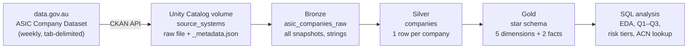
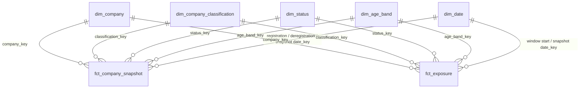

# Which New Businesses Are Riskiest to Lend To?
### SME business-survival analytics on the Australian company register

*Which young Australian companies are most likely to stop operating, and where should a lender tighten its criteria? An end-to-end project from the public ASIC company register to a Databricks lakehouse, a star schema, SQL survival analysis and lending recommendations.*

---

## Background and Overview

Banks and other lenders have very little history to judge a newly established business: no long trading record, often no financial statements, and no repayment history. Yet young companies make up a large part of the market. In the Australian company register, **half of all active companies are 7 years old or younger**.

This project uses the **ASIC Company Dataset**, the public register of every company in Australia (about **4.45 million records**, published weekly on data.gov.au), to measure **how likely companies are to be deregistered** at each age, by type of company and by warning signs a lender can see on an application.

**Stakeholder:** SME Credit Risk / Business Lending team, who set the bank's risk appetite and lending criteria for young businesses.

**The decision:** which kinds of new business should get standard lending criteria, which need extra checks or tighter terms, and which should be declined or referred?

**Why it matters:** about **1 in 18** Australian companies is deregistered in a typical year, and about **3 in 10** new companies are gone within 5 years. Applying the same criteria to every young company either turns away good borrowers or under-prices risky ones.

**Questions this project answers**
1. **When is a new company most at risk?** How likely is it to still be registered after 1, 2 and 5 years, and which age is the riskiest?
2. **Which types of company, and which warning signs, carry the most risk?** Borrower segments, then ABN held, name changes and numbered (ACN-named) companies within trading companies, compared on an age-adjusted basis.
3. **Where should lending criteria be tightened or relaxed?** A risk-tier table of borrower profiles, validated against actual outcomes, plus red-flag rules.

> **Important framing:** deregistration is used as a **proxy for a business stopping**. It is **not** the same as loan default: companies can also close voluntarily, merge or restructure. ASIC publishes only **the last 12 months** of deregistrations, so risk is measured with a period method (the last 12 months' rates at each age), not by following companies from birth.

---

## Executive Summary

**Headline numbers** (ASIC snapshot of **19 October 2026**; observation window **20 Oct 2025 – 19 Oct 2026**)

| Companies | Active | Distressed (strike-off / administration) | Deregistered in last 12 months | Company-years at risk | Yearly deregistration probability |
|---|---|---|---|---|---|
| 4,018,252 | 3,806,201 | 76,423 (2.01% of active) | 212,050 | 3,716,339 | **5.55%** |

**Key findings**
- **The third year is the danger zone.** A company aged 2–3 has a **14.0%** chance of being deregistered that year (trading companies **14.9%**), about **5× the year before**. It is the riskiest age for every segment, and it stays the riskiest after removing a large administrative batch of deregistrations.
- **About 3 in 10 new companies are gone within 5 years.** Survival is 99.2% at year 1, 96.4% at year 2, **83.0% at year 3** and **71.0% at year 5** (trading companies 69.3%).
- **A numbered company name is the strongest warning sign.** Trading companies with their ACN as their name are **twice as likely** to be deregistered within 5 years (**61.3% vs 30.7%**), and up to **7×** the average yearly risk at age 2–3.
- **Super trustee companies carry half the average risk** (risk index **0.47**). Leaving them in "all companies" makes risk look lower than it is for real trading businesses.
- **Risk tiers separate risk well.** The High and Elevated tiers cover **16% of trading-company exposure but 34% of deregistrations**; the High tier alone has a **lift of 3.06×**.
- **72,200 trading companies are currently in strike-off or external administration.**

**Recommendation:** **Tighten criteria for trading companies in their third year and for numbered companies aged 2+, monitor companies aged 3–5, keep standard criteria for established companies, and check ASIC status before every approval and during the loan.**

---

## Insights

### 1. Almost every company survives two years, then risk jumps in year three

Survival curves were built with an exposure-based period life table: for each age band, the yearly deregistration probability is `q = 1 − e^(−deregistrations ÷ company-years at risk)`, and survival to year *N* is the product of `(1 − q)` for each year.

Almost every company is still registered after two years (**96.4%**). Then there is a cliff: **about 1 in 7 companies still registered at year 2 are gone by year 3**. After year 3 the curve keeps falling, more gently, reaching **71.0%** at year 5. Trading companies sit slightly below the overall line at every age (69.3% at year 5), because the overall figure includes the much safer super trustee companies.

The first two years look very safe partly because **deregistration lags real failure**: striking a company off takes time (unpaid fees, notices, waiting periods), so a business that stops early often only shows up as deregistered in its second or third year. **A low first-year rate does not mean new companies are low risk; the risk shows up a little later.**

**Is the peak real?** Deregistrations are processed in batches (see *Data exploration* below), including an unusually large run in May–June 2026. Recalculating survival after removing **every** deregistration processed in May–June 2026 (a deliberately harsh test that also removes normal ones), age 2–3 is **still the riskiest year (8.83% vs 5.54% for the next band)**. The true 5-year survival lies between **71.0% and 79.4%**.

<details>
<summary>See the numbers</summary>

| Age | Yearly deregistration rate | Yearly probability (all) | Survival (all) | Yearly probability (trading) | Survival (trading) |
|---|---|---|---|---|---|
| 0–1 years | 0.82% | 0.82% | 99.2% | 0.85% | 99.2% |
| 1–2 years | 2.82% | 2.78% | 96.4% | 3.01% | 96.2% |
| 2–3 years | 15.03% | **13.96%** | **83.0%** | **14.87%** | **81.9%** |
| 3–4 years | 8.25% | 7.92% | 76.4% | 8.40% | 75.0% |
| 4–5 years | 7.39% | 7.13% | **71.0%** | 7.57% | **69.3%** |

**Sensitivity: without the May–June 2026 batch**

| Survive to year | Yearly probability | Yearly probability, excl. batch | Survival | Survival, excl. batch |
|---|---|---|---|---|
| 1 | 0.82% | 0.69% | 99.2% | 99.3% |
| 2 | 2.78% | 2.38% | 96.4% | 97.0% |
| 3 | 13.96% | 8.83% | 83.0% | 88.4% |
| 4 | 7.92% | 5.54% | 76.4% | 83.5% |
| 5 | 7.13% | 4.94% | 71.0% | 79.4% |

**Riskiest age band:** 2–3 years for trading companies (14.87%) and for all other segments combined (6.70%).

- The rate (`deregistrations ÷ company-years`) and the probability (`1 − e^(−rate)`) are almost identical except at age 2–3 (15.03% vs 13.96%).

*Source: Q1 analysis notebook (Databricks SQL on `fct_exposure`)*
</details>

### 2. Numbered trading companies are twice as risky; super trustees half as risky

Segments differ in age (not-for-profits and super trustees tend to be older), and age drives risk, so comparing raw shares would mislead. Each group is compared on its **chance of being deregistered within 5 years, `1 − S(5)`**, built from the group's own rate in each age band. The **relative risk index** divides that by a benchmark: 1.0 = average, above 1.25 = higher risk, below 0.80 = lower risk. A group needs at least 100 company-years and 10 deregistrations in every age band, otherwise it is shown as *not enough data*.

**By segment**, trading companies (87% of all companies and the main SME borrowers) sit just above average (**1.06**). Super trustee companies carry **less than half** the average risk (**0.47**). Not-for-profits looked safer on a crude count (0.81) but are **average once age is accounted for (1.02)**, because many are old: a clear example of why the age adjustment matters.

**Within trading companies**, a **numbered name** (the company's ACN used as its name, e.g. `123 456 789 PTY LTD`) is the strongest warning sign: **61.3%** are gone within 5 years against **30.7%** for all trading companies, a risk index of **2.00**, based on 620 deregistrations with enough data in every age band. Trading companies **with an ABN** are riskier (1.12) than those without (0.72); a likely reading is that companies that actually trade can fail, while many no-ABN companies are passive holding vehicles. Since loan applicants almost always hold an ABN, the higher figure is the realistic benchmark for lenders.

**Current distress** (strike-off or external administration) among active trading companies is **1.76%** under 5 years, **2.92%** at 5–10 years and **2.22%** at 10+ years, against 0.5–0.8% for super trustees. Young companies show *less* current distress, consistent with the delay before strike-off begins.

<details>
<summary>See the numbers</summary>

**Borrower segments (benchmark: all companies)**

| Segment | Company-years (age 0–5) | Deregistrations (age 0–5) | Survival to year 5 | Deregistered within 5 years | Risk index | Flag |
|---|---|---|---|---|---|---|
| All companies | 1,435,720 | 89,910 | 71.0% | 29.0% | 1.00 | benchmark |
| Trading company | 1,257,388 | 84,885 | 69.3% | 30.7% | 1.06 | Around average |
| Super trustee | 165,929 | 4,165 | 86.3% | 13.7% | **0.47** | **Lower risk** |
| Not-for-profit | 7,157 | 458 | 70.5% | 29.5% | 1.02 | Around average |
| Other public | 2,528 | 202 | 65.4% | 34.6% | 1.19 | Around average |
| Home unit | 816 | 149 | 36.8% | 63.2% | – | Not enough data |
| Foreign company | 1,384 | 48 | 83.9% | 16.1% | – | Not enough data |
| Registrable body | 507 | 3 | 97.0% | 3.0% | – | Not enough data |
| CCIV | 10 | 0 | 100.0% | 0.0% | – | Not enough data |

**Warning signs within trading companies (benchmark: all trading companies)**

| Signal | Group | Company-years (age 0–5) | Deregistrations (age 0–5) | Deregistered within 5 years | Risk index | Flag |
|---|---|---|---|---|---|---|
| Benchmark | All trading companies | 1,257,388 | 84,885 | 30.7% | 1.00 | |
| Name type | **Numbered (ACN in name)** | 3,942 | 620 | **61.3%** | **2.00** | **Higher risk** |
| Name type | Named | 1,253,446 | 84,265 | 30.6% | 1.00 | Around average |
| ABN held | Has ABN | 832,511 | 66,029 | 34.5% | 1.12 | Around average |
| ABN held | No ABN | 424,877 | 18,856 | 22.2% | 0.72 | Lower risk |
| Name history | Renamed | 33,750 | 1,773 | 21.2% | 0.69 | Lower risk* |
| Name history | Never renamed | 1,223,638 | 83,112 | 31.0% | 1.01 | Around average |

\*Name history is recorded at the snapshot, and deregistered companies can no longer rename, so this comparison leans towards survivors. It is not used as a lending signal.

**Current distress share of active companies**

| Segment | Under 5 years | 5–10 years | 10+ years |
|---|---|---|---|
| Trading company | 1.76% | 2.92% | 2.22% |
| Super trustee | 0.51% | 0.74% | 0.81% |
| Not-for-profit | 1.42% | 1.65% | 1.32% |

*Source: Q2 analysis notebook (Databricks SQL on `fct_exposure`, `fct_company_snapshot`, `dim_company`)*
</details>

### 3. Risk tiers: 16% of trading companies account for 34% of deregistrations

Every trading company was placed in one of **28 borrower profiles**: age band × numbered or named × ABN held or not, which are the three things a lender knows from an application. Each profile's yearly deregistration rate was compared with the trading-company average and placed in a tier:

| Tier | Rule (multiple of the trading-company average) |
|---|---|
| 🔴 High | above 2× |
| 🟠 Elevated | above 1.25× |
| 🟡 Standard | 0.8–1.25× |
| 🟢 Low | below 0.8× |
| ⚪ Insufficient data | fewer than 100 company-years or 10 deregistrations |

To avoid tiers driven by chance, a profile is only Elevated or High if the **lower end of its 95% interval** (`rate × e^(±1.96/√deregistrations)`) clears the cut-off, and only Low if the upper end is below 0.8×. The thresholds are illustrative policy defaults; a bank would set its own.

**High tier:** every numbered trading company aged 2 or more (up to **7×** average, about **35% a year** at age 2–3), plus **named trading companies with an ABN in their third year** (3.05×, 16.9% a year). That second group is the largest high-risk group, with about **158,000** active companies.
**Elevated:** named companies with an ABN aged 3–5 (1.5–1.6×), named companies without an ABN aged 2–3 (1.73×) and older numbered companies without an ABN.
**Low:** named companies under 2 years old, numbered companies under 1 year, and older companies without an ABN.

**The tiers separate risk well.** The High tier holds **5.4%** of trading-company exposure but **16.5%** of deregistrations (**lift 3.06×**); High and Elevated together hold **16%** of exposure and **34%** of deregistrations. In lending terms: **tightening criteria for about 1 in 6 trading companies targets about 1 in 3 failures.**

On top of the tiers, a **red-flag rule** applies to any company currently in strike-off or external administration: **72,200 trading companies** (40,955 strike-off, 31,245 external administration) should be declined or referred whatever their profile.

<details>
<summary>See the numbers</summary>

**Capture (lift) table**

| Tier | Profiles | Active companies | % of active companies | % of company-years | % of deregistrations | Lift |
|---|---|---|---|---|---|---|
| 🔴 High | 9 | 162,630 | 5.1% | 5.4% | 16.5% | **3.06** |
| 🟠 Elevated | 5 | 344,487 | 10.7% | 10.9% | 17.5% | 1.60 |
| 🟡 Standard | 7 | 1,660,839 | 51.6% | 51.9% | 50.0% | 0.96 |
| 🟢 Low | 7 | 1,049,985 | 32.6% | 31.8% | 16.0% | 0.50 |

**All 28 profiles**

| Tier | Age | Name | ABN | Active companies | Company-years | Deregistrations | Yearly probability | × trading average | 95% interval |
|---|---|---|---|---|---|---|---|---|---|
| High | 2–3 | Numbered | No ABN | 184 | 233 | 105 | 36.28% | 7.42 | 6.13–8.99 |
| High | 2–3 | Numbered | Has ABN | 436 | 508 | 216 | 34.65% | 7.01 | 6.13–8.01 |
| High | 3–4 | Numbered | No ABN | 166 | 139 | 33 | 21.07% | 3.90 | 2.77–5.48 |
| High | 3–4 | Numbered | Has ABN | 304 | 333 | 76 | 20.39% | 3.75 | 3.00–4.70 |
| High | 4–5 | Numbered | No ABN | 94 | 142 | 28 | 17.89% | 3.25 | 2.24–4.70 |
| High | 4–5 | Numbered | Has ABN | 236 | 346 | 67 | 17.60% | 3.19 | 2.51–4.05 |
| High | 2–3 | Named | Has ABN | 157,698 | 167,038 | 30,972 | 16.92% | 3.05 | 3.02–3.09 |
| High | 5–10 | Numbered | Has ABN | 1,109 | 1,484 | 269 | 16.57% | 2.98 | 2.65–3.36 |
| High | 10+ | Numbered | Has ABN | 2,403 | 3,169 | 499 | 14.57% | 2.59 | 2.38–2.83 |
| Elevated | 5–10 | Numbered | No ABN | 545 | 604 | 71 | 11.10% | 1.94 | 1.54–2.44 |
| Elevated | 10+ | Numbered | No ABN | 1,250 | 1,356 | 155 | 10.80% | 1.88 | 1.61–2.20 |
| Elevated | 2–3 | Named | No ABN | 80,560 | 76,511 | 8,023 | 9.95% | 1.73 | 1.69–1.77 |
| Elevated | 3–4 | Named | Has ABN | 138,422 | 139,286 | 13,896 | 9.50% | 1.64 | 1.62–1.67 |
| Elevated | 4–5 | Named | Has ABN | 123,710 | 133,991 | 12,027 | 8.58% | 1.48 | 1.45–1.50 |
| Standard | 5–10 | Named | Has ABN | 447,897 | 451,698 | 34,556 | 7.36% | 1.26 | 1.25–1.27 |
| Standard | 1–2 | Numbered | Has ABN | 649 | 609 | 43 | 6.81% | 1.16 | 0.86–1.57 |
| Standard | 3–4 | Named | No ABN | 64,921 | 65,455 | 4,002 | 5.93% | 1.01 | 0.98–1.04 |
| Standard | 4–5 | Named | No ABN | 65,475 | 72,320 | 4,165 | 5.60% | 0.95 | 0.92–0.98 |
| Standard | 5–10 | Named | No ABN | 247,761 | 244,412 | 13,202 | 5.26% | 0.89 | 0.87–0.90 |
| Standard | 1–2 | Numbered | No ABN | 376 | 296 | 15 | 4.94% | 0.83 | 0.50–1.38 |
| Standard | 10+ | Named | Has ABN | 833,760 | 836,509 | 41,795 | 4.87% | 0.82 | 0.82–0.83 |
| Low | 10+ | Named | No ABN | 431,009 | 423,395 | 20,076 | 4.63% | 0.78 | 0.77–0.79 |
| Low | 1–2 | Named | Has ABN | 189,439 | 184,075 | 6,680 | 3.56% | 0.60 | 0.58–0.61 |
| Low | 0–1 | Numbered | Has ABN | 825 | 810 | 24 | 2.92% | 0.49 | 0.33–0.73 |
| Low | 0–1 | Numbered | No ABN | 618 | 525 | 13 | 2.45% | 0.41 | 0.24–0.70 |
| Low | 1–2 | Named | No ABN | 104,732 | 93,875 | 1,796 | 1.90% | 0.32 | 0.30–0.33 |
| Low | 0–1 | Named | Has ABN | 210,006 | 205,513 | 2,028 | 0.98% | 0.16 | 0.16–0.17 |
| Low | 0–1 | Named | No ABN | 113,356 | 115,381 | 676 | 0.58% | 0.10 | 0.09–0.10 |

- Named companies with an ABN aged 5–10 (1.26×) sit on the Elevated boundary: their interval touches 1.25, so they stay Standard.
- No profile fell into *Insufficient data*.
- Active companies exclude those currently in strike-off or administration (covered by the red-flag rule).
- The same profile table drives an **ACN lookup**: given a company's ACN, it returns the company's segment, status, age band, profile, tier and any red flag.

*Source: Q3 analysis notebook (Databricks SQL, temporary view `q3_profile_risk`)*
</details>

> **Overall:** risk for young companies is concentrated in a few identifiable profiles. Third-year trading companies and numbered companies carry most of the excess risk, and a simple ASIC status check catches companies already on their way out.

---

## Recommendations

Thresholds are illustrative and the analysis measures deregistration, not default; expected impact is described qualitatively.

**Credit criteria**
1. **(P0) Tighten criteria in the third year.** For trading companies aged 2–3, ask for stronger serviceability evidence, shorter terms or security. *Evidence:* the riskiest year (14.9% yearly for trading companies, 3.05× average for named companies with an ABN). *Metric to watch:* share of approvals in the High tier; deregistration rate of approved third-year borrowers.
2. **(P0) Treat a numbered company name as a risk flag** for trading companies aged 2 or more: extra verification of directors and trading history, lower limits or security. *Evidence:* 2× the 5-year risk; 3–7× the average yearly rate from age 2. *Metric to watch:* numbered-company share of new lending.
3. **(P1) Price or monitor Elevated profiles rather than declining them** (trading companies aged 3–5). *Evidence:* 1.5–1.7× average; 10.9% of exposure, 17.5% of deregistrations.
4. **(P1) Do not relax criteria for companies under 2 because they look "Low".** Assess risk over the loan term: a 3-year loan to a new company spans the riskiest year (only 81.9% of trading companies are still registered at year 3). *Metric to watch:* cumulative risk over the loan term rather than current-age risk.

**Monitoring**

5. **(P0) Check ASIC status before approval and during the loan**, using the weekly file. *Evidence:* 72,200 trading companies currently in strike-off or external administration. *Metric to watch:* borrowers entering strike-off or administration each week.

**Model governance**

6. **(P1) Calibrate the tiers with the bank's own loan outcomes.** Deregistration is a proxy; the cut-offs should be tuned to actual credit losses.

---

## Data exploration

Before answering the questions, the Gold tables were explored with SQL (dimension, measures, magnitude, change-over-time and part-to-whole analysis). The findings below shaped how the results are read.

- **Deregistrations are processed in batches.** **40.7%** are dated on a **Sunday** and 28.4% on a Wednesday, against 0.7% on Saturdays. The seven busiest single days are all Sundays in May–June 2026 (up to **8,368** in one day). A deregistration date is the day ASIC processed it, not the day the business stopped.
- **The May 2026 spike** (38,698 deregistrations, about 2–3× a normal month of 12k–21k) is a run of large Sunday batches; 28% were companies aged 2–3. In normal months, age 2–3 is still **18–20%** of deregistrations while holding about **8%** of companies, so the peak is not only the batch.
- **The 30 June effect:** the last week of June holds **2.9–5.0%** of each financial year's registrations, against about 1.9% for an average week.
- **Who takes more than their share** (share of deregistrations ÷ share of company-years): age 2–3 **2.63×**, age 3–4 1.45×, age 0–1 0.14×; trading companies 1.06×, super trustees 0.56×. Trading companies also hold **94.5%** of all currently distressed companies.
- **Crude comparisons mislead:** on raw counts, companies with an ABN looked riskier than those without and renamed companies looked safer. These patterns are largely driven by age and segment mix, which is why the questions use age-adjusted measures.

<details>
<summary>See the numbers</summary>

**Key metrics**

| Measure | Value |
|---|---|
| Total companies | 4,018,252 |
| Companies in analysis population (excludes 1 dissolved) | 4,018,251 |
| Active companies | 3,806,201 |
| Distressed companies (strike-off + administration) | 76,423 |
| Distress share of active | 2.01% |
| Deregistered in the last 12 months | 212,050 |
| Company-years at risk | 3,716,339 |
| Yearly deregistration probability | 5.55% |
| Companies with an ABN | 59.4% |
| Companies ever renamed | 8.3% |
| Numbered (ACN-named) companies | 0.31% (12,555) |
| Median age of active companies | 7 years (mean 10.6, oldest 209) |

**Companies by segment and age band**

| Group | Companies | % of companies | Active | Distressed | Deregistered (12 months) |
|---|---|---|---|---|---|
| Trading company | 3,485,652 | 86.75% | 3,290,143 | 72,200 | 195,509 |
| Super trustee | 488,278 | 12.15% | 473,648 | 3,238 | 14,630 |
| Not-for-profit | 23,137 | 0.58% | 22,137 | 314 | 999 |
| Other public | 11,762 | 0.29% | 11,229 | 461 | 533 |
| Foreign company | 4,695 | 0.12% | 4,539 | 129 | 156 |
| Home unit | 2,640 | 0.07% | 2,426 | 56 | 214 |
| Registrable body | 2,077 | 0.05% | 2,068 | 25 | 9 |
| CCIV | 11 | 0.00% | 11 | 0 | 0 |
| Age 0–1 years | 382,655 | 9.52% | 379,581 | 968 | 3,074 |
| Age 1–2 years | 354,393 | 8.82% | 345,368 | 2,526 | 9,025 |
| Age 2–3 years | 324,707 | 8.08% | 283,167 | 9,256 | 41,540 |
| Age 3–4 years | 255,831 | 6.37% | 236,807 | 5,541 | 19,024 |
| Age 4–5 years | 236,074 | 5.88% | 218,827 | 5,293 | 17,247 |
| Age 5–10 years | 877,929 | 21.85% | 825,866 | 21,885 | 52,063 |
| Age 10+ years | 1,586,659 | 39.49% | 1,516,582 | 30,954 | 70,076 |

**Deregistrations per month**

| Month | Deregistrations | Month | Deregistrations |
|---|---|---|---|
| Oct 2025 (from 20th) | 5,706 | Apr 2026 | 15,235 |
| Nov 2025 | 13,365 | **May 2026** | **38,698** |
| Dec 2025 | 12,901 | Jun 2026 | 20,967 |
| Jan 2026 | 15,794 | Jul 2026 | 16,307 |
| Feb 2026 | 11,906 | Aug 2026 | 17,785 |
| Mar 2026 | 11,735 | Sep 2026 | 20,326 |
| | | Oct 2026 (to 19th) | 11,325 |

Total: 212,050.

**Deregistrations by day of the week:** Sunday 40.7% · Wednesday 28.4% · Monday 13.0% · Thursday 7.7% · Friday 7.4% · Tuesday 2.1% · Saturday 0.7%.

*Source: `exploratory_data_analysis` notebook*
</details>

---

## Appendix: Technical Details

### A. Metric definitions

| Metric | Definition | Value (19 Oct 2026 snapshot) |
|---|---|---|
| **Company-years at risk (exposure)** | Time each company was registered inside the observation window, from the later of the window start and its registration date until deregistration or the window end, split at each anniversary into age bands | 3,716,339 |
| **Deregistration rate** | Deregistrations ÷ company-years at risk | 5.71 per 100 company-years |
| **Yearly deregistration probability** | `q = 1 − e^(−rate)`: chance of being deregistered within one year | 5.55% (all ages) |
| **Survival to year N** | `S(N) = (1 − q₁) × … × (1 − q_N)`, equivalently `e^(−Σ rate)`; period method | S(1) 99.2% · S(2) 96.4% · S(3) 83.0% · S(5) 71.0% |
| **Relative risk index** | `(1 − S(5))` of a group ÷ `(1 − S(5))` of the benchmark; age-adjusted. Above 1.25 = higher risk, below 0.80 = lower risk | Trading 1.06 · Super trustee 0.47 · Numbered trading 2.00 |
| **Distress share** | (Strike-off + external administration) ÷ active companies | 2.01% |
| **Over-representation / lift** | Share of deregistrations ÷ share of company-years | Age 2–3: 2.63 · High tier: 3.06 |
| **95% interval on a rate** | `rate × e^(±1.96/√d)`, d = deregistrations (Poisson approximation) | Used to gate risk tiers |
| **Reliability rule** | At least 100 company-years and 10 deregistrations in each age band used | – |

**Definitions**
- **Active:** status Registered, Strike-off action in progress, External administration or Not active.
- **Distressed:** strike-off action in progress (SOFF) or external administration (EXAD).
- **Analysis population:** all companies except cancelled (CNCL) and dissolved (DISS).
- **Age:** full years since registration, counted on anniversaries. Bands: 0–1, 1–2, 2–3, 3–4, 4–5, 5–10, 10+ years.
- **Numbered company:** the company's own ACN appears in its name (e.g. `ACN 094 072 214 PTY LTD`).
- **Borrower segment:**

  | Segment | Rule |
  |---|---|
  | Trading company | Proprietary companies (excluding the segments below) |
  | Super trustee | Proprietary superannuation trustee (PSTC) |
  | Not-for-profit | ULSN, PNPC, NLTD |
  | Home unit | HUNT |
  | Other public | Remaining public companies |
  | Foreign company | FNOS |
  | Registrable body | RACN |
  | CCIV | Corporate collective investment vehicles |

### B. Assumptions and caveats

**Assumptions**
- **Deregistration as a proxy:** a deregistered company is treated as a business that stopped operating. It is not loan default.
- **Period method:** survival assumes the last 12 months' deregistration rates at each age continue.
- **Observation window:** computed from each snapshot as the earliest deregistration date in the file to the snapshot date (20 Oct 2025 – 19 Oct 2026, 364 days), because ASIC keeps one year of deregistrations.
- **Status is authoritative:** a deregistration date is only used when the status is Deregistered (9 companies with a date but another status are flagged as likely reinstatements).
- **Tier thresholds** (0.8×, 1.25×, 2×) and segment rules are analyst choices, not bank policy.

**Caveats**
- **Deregistration lags failure,** so early-age risk is understated and appears in later years.
- **Deregistration dates are processing dates** (Sunday batches, May–June 2026 spike). The main finding was tested without the batch.
- **No current location:** the register's "previous state" is pre-1991 registration history, so there is no state-level view.
- **ABN held** means an ABN is recorded by ASIC, not that it is currently active.
- **Name history** is recorded at the snapshot and biased towards survivors.
- **Registration date** may be the date a company joined the ASIC register for some post-1991 transfers (333 companies, including 58 Norfolk Island companies all dated 2 Aug 2021).
- **Interpretations, not proven causes:** explanations such as holding vehicles without an ABN or ASIC strike-off batches are readings of the patterns, not tested causes.

### C. Architecture

The project is a **medallion lakehouse on Databricks**, using Delta Lake tables governed in Unity Catalog, orchestrated as a Databricks Job.



| Layer | Object | Load pattern | What happens |
|---|---|---|---|
| **Landing** | Volume `sme_risk_bronze.source_systems` | New folder per snapshot | Raw ASIC file stored unchanged in `snapshot_date=YYYY-MM-DD/`, with `_metadata.json` (source URL, ASIC last-modified date, size, SHA-256) |
| **Bronze** | `sme_risk_bronze.asic_companies_raw` | Append per snapshot (Delta `replaceWhere`, idempotent) | Every weekly snapshot kept; all 15 source columns as text plus load metadata. **History lives here** |
| **Silver** | `sme_risk_silver.companies` | Overwrite from the latest snapshot | Cleaning, typing, deduplication to one row per company, name history, business flags, code labels, 22 validation checks |
| **Gold** | 5 dimensions + 2 facts in `sme_risk_gold` | Overwrite from Silver | Star schema for analysis, 22 integrity checks, table and column descriptions |

**Star schema**



| Table | Grain | Rows (19 Oct 2026) | Key | Contents |
|---|---|---|---|---|
| `dim_company` | Company | 4,018,252 | `company_key` = ACN as a number | Name, registration date, ABN, numbered flag, former names, date of current name, renamed in last 12 months, previous state |
| `dim_company_classification` | Type + class + sub-class | 35 | `classification_key` (e.g. `APTY-LMSH-PROP`) | ASIC labels and the **borrower segment** |
| `dim_status` | Status code | 6 | `status_key` = status code | Labels, active / distressed / deregistered flags, status group |
| `dim_age_band` | Age band | 8 | `age_band_key` 0–7 | Band label, min/max years, age group |
| `dim_date` | Day (1817–2026) | 76,702 | `date_key` = YYYYMMDD (0 = no date) | Calendar and **Australian financial year** attributes |
| `fct_company_snapshot` | Company × snapshot | 4,018,252 | – | Status, age band, dates; 0/1 measures (active, distressed, deregistered) |
| `fct_exposure` | Company × age band in the window | ~5.5M | – | Company-years at risk and deregistrations: the input for every survival metric |

Keys are readable and stable from week to week (no generated row numbers), so the same company always has the same key.

### D. Pipeline and orchestration

The three layers run as one **Databricks Job, `sme_risk_weekly_pipeline`**, on serverless compute. The job definition is version-controlled as YAML in [`jobs/sme_risk_weekly_pipeline.yml`](jobs/sme_risk_weekly_pipeline.yml).

| Task | Notebook | Depends on | Typical run time |
|---|---|---|---|
| `bronze_layer` | [`notebooks/bronze_ingest`](notebooks/bronze_ingest.ipynb) | – | ~1m 50s (1 retry after 15 min) |
| `silver_layer` | [`notebooks/silver_transform`](notebooks/silver_transform.ipynb) | `bronze_layer` | ~2m 40s |
| `gold_layer` | [`notebooks/gold_build`](notebooks/gold_build.ipynb) | `silver_layer` | ~3m 20s |

End to end: **about 8 minutes**. Any failed validation stops the job before later layers run. Rerunning is safe: Bronze skips snapshots it already holds, and Silver and Gold rebuild the same tables.

**Bronze (`bronze_ingest`)**
- Finds the latest file through the data.gov.au CKAN API and downloads it in streamed chunks (`.part` file renamed on completion).
- Loads it with tab delimiter, quoting off and every column as text.
- Stops unless the header matches the 15 documented columns, the row count equals the raw line count and every line has exactly 14 tabs.
- Applies table, column and volume descriptions from the ASIC help file.

**Silver (`silver_transform`)**: PySpark plus SQL
- Filters Bronze to the latest snapshot and renames columns to business names (`type` → `company_type`, `status` → `status_code`, …).
- Cleans text: decodes CSV escaping in names, strips control characters, trims and collapses spaces, turns blanks into nulls (regex functions).
- Parses DD/MM/YYYY dates safely (`try_to_timestamp`, unparseable flags first), turns the ABN placeholder `0` into null and Y/blank flags into booleans.
- Deduplicates to one row per company with SQL CTEs, keeping name history from former-name rows (`COUNT_IF`, `ARRAY_SORT(COLLECT_LIST(...))`, `MAX`).
- Adds business flags and ASIC code labels (`create_map` + `try_element_at`).
- Validates with 22 hard stops, writes the table and applies column descriptions.

**Gold (`gold_build`)**: Spark SQL into DataFrames
- Builds each dimension and fact with one SQL query.
- Generates the date dimension with `explode(sequence(...))`.
- Splits each company's time at risk at its anniversaries with `add_months`, `months_between` and `LATERAL VIEW explode` to build `fct_exposure`.
- Runs 22 integrity checks (duplicate keys, orphan keys with `LEFT ANTI JOIN`, fact-to-Silver reconciliation, exposure totals) and applies descriptions to all 78 Gold columns.

**Analysis**: Databricks SQL notebooks on the Gold tables: CTEs, window functions (`LAG`, running `SUM() OVER`, `ROW_NUMBER() OVER (PARTITION BY …)`), conditional aggregation, `EXP(SUM(LN(...)))` as a running product for survival, `UNION ALL` report tables and temporary views.

### E. Data source

| Source | Publisher | Format | Rows (19 Oct 2026) | Columns | Update |
|---|---|---|---|---|---|
| ASIC Company Dataset (`asic-companies`) | Australian Securities & Investments Commission, via data.gov.au | Tab-delimited text (named `.csv`) | 4,452,194 | 15 | Weekly |

The file holds every currently registered company, companies deregistered in the past year, and one extra row for each former company name, so one row per **name**, not per company. It contains 4,018,291 distinct ACNs.

Columns: company name, ACN, type, class, sub-class, status, date of registration, date of deregistration, previous state of registration, state registration number, modified since last report, current name indicator, ABN, current name, current name start date.

### F. Data quality and cleaning

Profiling was done column by column in [`notebooks/silver_profile`](notebooks/silver_profile.ipynb) (first profiled on the 12 Oct 2026 snapshot).

| Issue found | Size | Fix applied (Silver) |
|---|---|---|
| One row per company name, not per company | ~434,000 former-name rows | Kept the current-name row per ACN; former names kept as `former_names`, `former_name_count`, `current_name_start_date` |
| ACNs with no current-name row | 39 (all cancelled) | Removed; hard stop if any non-cancelled company ever appears |
| Names wrapped in CSV quotes with doubled inner quotes | 429 | Decoded (verified against the ASIC online register, e.g. `GO "N" OFF PTY LTD`) |
| Leading/trailing spaces in names | 45,798 | Trimmed |
| Repeated spaces in names | 46,776 | Collapsed to one space |
| ABN `0` used for "no ABN" | 1,631,208 (40.6%) | Set to null; `has_abn` flag added |
| Hidden trailing space in state codes (`SA `, `WA `, `NT `) | 47 | Trimmed |
| Character `º` (U+00BA) replacing `\|` in the export | 4 names (1 current) | Flagged (`company_name_has_export_artifact`), not changed |
| Sub-class code not in the ASIC help file (`WHSL`) | 13 rows | Added to the code dictionary with an inferred label |
| Deregistration date on a non-deregistered company | 9 | Status kept as authoritative; flagged (`dereg_date_status_conflict`) |
| Missing registration date | 4 | Kept; age band "Unknown", excluded from age-based metrics |
| Dates as DD/MM/YYYY text | All rows | Parsed to DATE; 0 unparseable, 0 in the future, 0 deregistrations before registration |

**Checked and kept as they are**
- **ACNs:** 100% valid 9-digit numbers including the ASIC check digit (0 failures across 4.45M rows); 15% have leading zeros, so they are stored as text.
- **ABNs:** every real ABN passes the format and mod-89 check digit, and none is shared between companies. 266 are not derived from the company's ACN (charities, foreign companies); they are genuine.
- **Asterisks in names** (e.g. `CREATE*IT PTY LTD`) are genuine and kept.
- **Registration dates** cluster around 30 June each year: the end of the Australian financial year, not placeholder dates.

**Validation summary:** 3 load checks in Bronze, **22 hard stops in Silver** (format and check digits, unknown codes, impossible dates, duplicates, row-count reconciliation) and **22 in Gold** (key uniqueness, orphan keys, reconciliation with Silver, exposure totals). Every one passes on the 19 Oct 2026 snapshot.

**Known limitations**
- ASIC keeps deregistered companies for one year only, so long-term outcomes cannot be followed company by company.
- The register has no current address or industry, so risk cannot be split by state or industry.
- Code labels for `CCIV` and `WHSL` are not in the ASIC help file and are inferred.
- 333 companies have a pre-1991 state of registration but a registration date after 1991; their age may be understated.

### G. Repository structure

```
├── README.md
├── CONTEXT.md                        # working notes and decisions log
├── .databricks/commit_outputs        # which notebooks keep their outputs in Git
├── jobs/
│   └── sme_risk_weekly_pipeline.yml  # Databricks Job definition
└── notebooks/
    ├── bronze_ingest.ipynb           # pipeline: download + Bronze load
    ├── silver_transform.ipynb        # pipeline: clean, deduplicate, validate, write Silver
    ├── gold_build.ipynb              # pipeline: star schema + integrity checks + descriptions
    └── silver_profile.ipynb          # column profiling behind the cleaning decisions
```

### H. Tech stack

| Area | Tools |
|---|---|
| Languages | Python, PySpark, Spark SQL |
| Platform | Databricks (serverless compute, Jobs, Git folders) |
| Storage and governance | Delta Lake, Unity Catalog (catalog, schemas, volume, table and column descriptions) |
| Ingestion | data.gov.au CKAN API (`requests`), SHA-256 file checksums |
| Modelling | Medallion architecture, star schema (5 dimensions, 2 facts) |
| Analysis | Exposure-based period life table, age-adjusted relative risk index, Poisson confidence intervals, lift / capture analysis, window functions |
| Version control | Git, GitHub |

## Acknowledgements

Data: **ASIC Company Dataset**, published by the Australian Securities & Investments Commission on [data.gov.au](https://data.gov.au/data/dataset/asic-companies).

## About Me

**Manaswini Doma**

[https://www.linkedin.com/in/domamanaswini/](https://www.linkedin.com/in/domamanaswini/) ·
[domamanaswini@gmail.com](mailto:domamanaswini@gmail.com)
